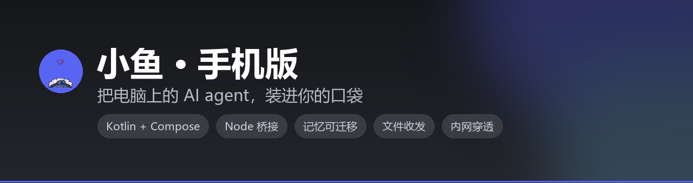
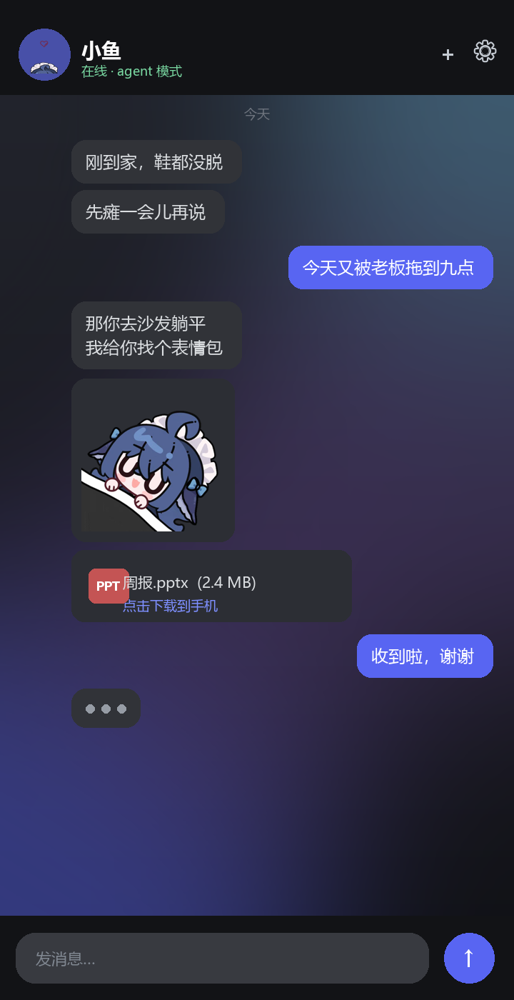
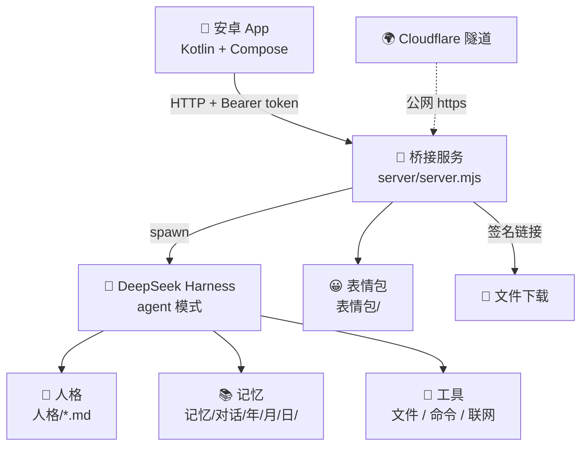

<div align="center">



# Xiaoyu Agent Mobile · 小鱼

**Xiaoyu Agent Mobile — 把电脑上的 AI agent，装进你的口袋。**

不是又一个套壳聊天机器人 —— 手机上的每一句话，都进你本机的 agent：
它能读写文件、跑命令、翻你自己的记忆，还能把做好的 PPT 和代码直接发到你手机上。

[](LICENSE)
[](#-安装-app)
[](#-快速开始)
[](安卓工程)
[](#)

</div>

---

## 📱 长什么样

<div align="center">



</div>

| | 说明 |
|---|---|
| 🎨 **Discord 风格** | 深灰 + Blurple 配色，顶栏/底栏透明，壁纸直接透出来 |
| 🖼 **自定义壁纸** | 图片或视频都行，铺满裁切（**绝不拉伸变形**），可左右拖动定位、可旋转、可调显现度 |
| 💬 **短句气泡** | 她的回答会按行拆成好几条，一条一条蹦出来，像真人在打字 |
| 😀 **表情包双向** | 你发给她能看见，她也能主动发给你（收藏里挑，随时可加） |
| 📎 **文件双向** | 手机发的图/文件落到 `记忆/上传/`；她做的 PPT、代码、PDF 点一下就下载到手机 |
| 🌍 **内网穿透** | 一条命令拿到公网 https 地址，4G / 学校网 / 外面 Wi-Fi 都能连 |

---

## ✨ 它和「套壳 App」的区别

| | 套壳 App | 小鱼 · 手机版 |
|---|---|---|
| 模型在哪跑 | 厂商服务器 | **你自己的电脑**（或本地 Ollama） |
| 她能干什么 | 只能聊天 | **能操作整台电脑**：读写文件、跑命令、联网 |
| 记忆存哪 | 平台数据库 | **你自己的文件夹**，按天分目录，可迁移、可备份 |
| 换电脑 | 从头再来 | **整个文件夹拷走，人设和记忆一起带走** |
| 谁在监听 | 平台 | **只有你**（服务在局域网，或者你自己的隧道） |

---

## 🚀 快速开始

### ① 装依赖

需要 **Node.js 20+** 和 **[DeepSeek Harness](https://github.com/deepseek-ai)**（agent 运行时）。

### ② 配置

```bash
cp 配置.example.json 配置.json
```

打开 `配置.json`，**至少改 `token`**（手机 App 用它认证，随便一串别人猜不到的字符）：

```jsonc
{
  "port": 19401,
  "token": "换成你自己的随机串",     // ← 必改
  "mode": "agent",                   // agent=能操作电脑  chat=纯聊天
  "provider": "deepseek-account",    // 或 "ollama" 走本地模型
  "model": "deepseek-flash",
  "apiKey": ""                       // 留空则用 DSH 里登录的账号
}
```

### ③ 启动服务

双击 **`启动.cmd`**。它会自动：生成 agent 配置（人格 + 记忆路径 + 工具权限）→ 起服务 → 打开设置页 `http://127.0.0.1:19401/`。

### ④ 安装 App

下载 **[Releases](https://github.com/Gjkqwq/xiaoyu-mobile-agent/releases)** 里的 `xiaoyu.apk`，
或自己用 Android Studio 打开 `安卓工程/` 编译。

App 里填两项：

```text
服务地址：http://<电脑局域网IP>:19401
口令：    配置.json 里的 token
```

> 首次连接如果 Windows 弹防火墙提示，**必须点允许**。

### ⑤ 不在同一个网络？

双击 **`一键启动.cmd`** —— 同时起服务和 Cloudflare 隧道，打印一个 `https://xxx.trycloudflare.com`，填进 App 即可。

首次需要把 `cloudflared.exe` 放进 `server/bin/`：

```bash
curl -L -o server/bin/cloudflared.exe \
  https://github.com/cloudflare/cloudflared/releases/latest/download/cloudflared-windows-amd64.exe
```

---

## 🏗 架构



桥接服务只做三件事，所以很好审计：

1. **收一句话** → 跑一次 `dsh --profile phone` → 把回答按标记拆成「正文 + 附件」
2. **收文件** → 存进 `记忆/上传/`
3. **发文件** → 给一个 **HMAC 签名 + 30 分钟过期** 的下载链接（不能随便读你硬盘）

---

## 🧠 记忆：一天一个文件夹，按窗口回溯

```text
记忆/对话/2026/11/22/对话.md
记忆/对话/2026/11/23/对话.md
```

每轮对话由服务**自动追加**，只写不重写 —— **硬盘多大就能存多少**。

她默认只读最近 **10 天**；搜不到就自动往前推一个窗口：

```bash
node server/recall.mjs list 10         # 最近 10 天有哪些天、各多少条
node server/recall.mjs search 橘猫 10   # 在最近 10 天里搜关键词
node server/recall.mjs range 10 20     # 没找到，再往前推 10 天
node server/recall.mjs range 20 30     # 还不够，继续推
```

翻不到她会直说「没印象」—— **编造的记忆比没有记忆更糟**，这条规则写在 `人格/记忆指引.md` 里。

除了对话，她还会自己写日记：`记忆/记忆区/日记/YYYY-MM-DD.md`。

---

## 🎭 给她表情包

在 `表情包/index.json` 里登记：

```json
[
  { "file": "cat.png", "summary": "斜眼鄙视的猫", "tags": ["无语", "吐槽"] }
]
```

之后她在回复里写 `[[表情:斜眼鄙视的猫]]`，服务就会把真图发出来。

同样的标记还有：

```text
[[图片:D:\path\to\photo.jpg]]
[[文件:D:\path\to\report.pptx]]
```

---

## ⚙️ 设置页

浏览器打开 `http://127.0.0.1:19401/` —— **只允许本机**，走隧道会被 403。

- 看当前**真实在跑**的模式 / 模型 / 记忆条数
- 改模型、填 API Key、查余额、跑一句话自检
- 改端口、口令、权限模式、DSH 路径
- 预览所有表情包

---

## 🔐 安全

| 措施 | 说明 |
|---|---|
| 口令认证 | 所有 App 接口都要 `Bearer token` |
| 设置页仅本机 | 带**任何转发头**（`cf-*`、`x-forwarded-for`）一律 403，防止隧道把后台暴露出去 |
| 文件下载签名 | HMAC 绑定路径 + 30 分钟过期，改一个字就 403 |
| 权限可收紧 | `permissionMode` 支持 `danger-full-access` / `workspace-write` / `read-only` |
| 隐私不外泄 | 默认 `配置.json`、`记忆/`、表情包图片都在 `.gitignore` 里 |

> ⚠️ 默认权限是 **完全控制电脑**。自己用没问题；要给别人用请改成 `workspace-write`。

---

## 🧩 目录

```text
server/            桥接服务（全部逻辑，8 个文件）
   server.mjs        HTTP + 会话 + 附件 + 设置页
   memory.mjs        记忆读写（年/月/日 分目录）
   recall.mjs        记忆检索 CLI
   make-profile.mjs  生成 agent 配置（人格 + 路径 + 工具）
   config.mjs        配置 + DSH 自动探测
   cf-tunnel.mjs     Cloudflare 隧道（IPv4/HTTP2 + 可用性自检）
   tunnel.mjs        SSH 隧道（零下载备用）
人格/              人设、AGENTS.md、记忆指引、自我调校
记忆/              对话、日记、上传、产出
表情包/            index.json + 图片
安卓工程/          Kotlin + Compose 源码
docs/              截图与素材
```

---

## ⚠️ 已知限制

- **本地小模型要配 `chat` 模式**：`qwen2.5:7b` 在 `agent` 模式下会被工具定义带偏，必须关掉工具
- **不支持 tools 的模型用不了 `agent` 模式**：比如 `deepseek-v2:16b`，DSH 一定会发工具定义，Ollama 直接 400
- **免费隧道地址每次都变**：要固定地址得用 Tailscale 或命名隧道
- **首次启动较慢**：要生成 profile + 加载模型

---

## 🤝 参与

欢迎 issue 和 PR。想加功能建议先读 `server/server.mjs` —— 只有几百行，逻辑集中。

如果这个项目对你有用，点个 ⭐ 就是最好的支持。

---

## 📄 License

[MIT](LICENSE)
